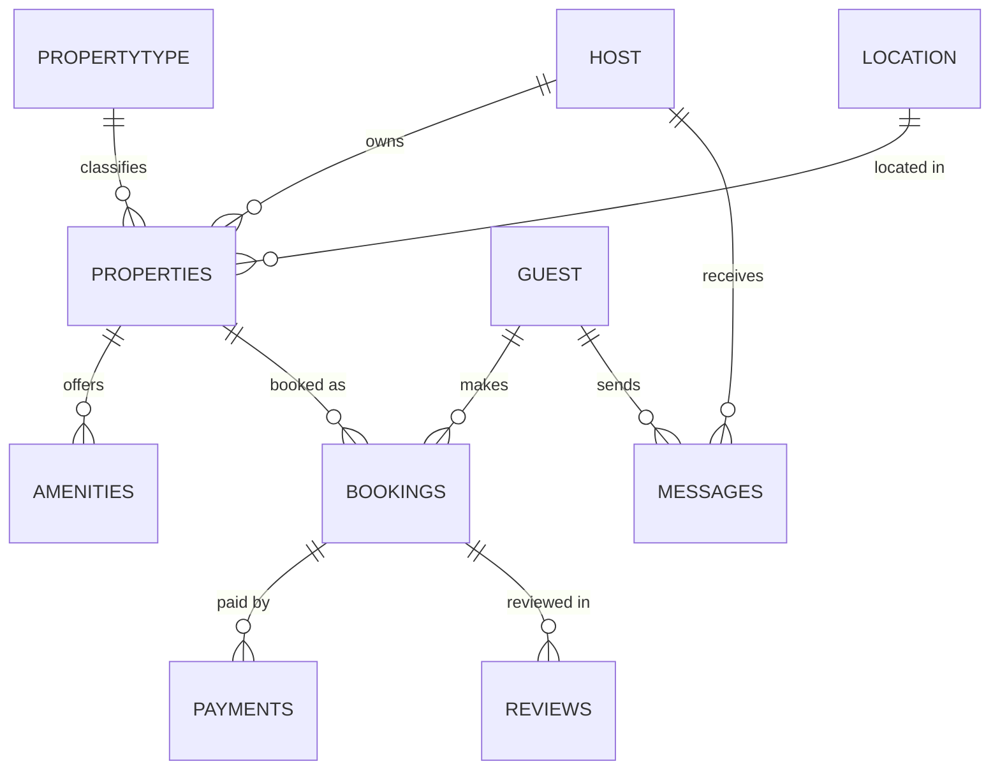

# Airbnb-Style Booking Database (MySQL)

A relational database for a short-term rental platform: guests, hosts, properties, bookings, payments, reviews and messages. It includes views, stored procedures, triggers, indexes, JSON and XML handling, a set of analysis queries, and data quality checks.

This was a school project. The data is synthetic (randomly generated names, emails, addresses and ratings), so the query results show that the SQL works, not real rental market behaviour.

## Schema

10 tables, about 1,500 bookings, 1,500 payments, 1,500 reviews, 836 properties, 440 guests and hosts.

Semi-structured data: `reviews.Analysis` and `properties.Description` hold JSON, `propertytype.TypeDetails_XML` holds XML in a TEXT column (MySQL has no native XML type).

## Files

| File | What it does |
|---|---|
| `sql/01_restore_database.sql` | Creates and loads the `project` database: tables, data, views, indexes, log tables |
| `sql/02_stored_procedures.sql` | `UpdateBookingStatus`, `CancelOverdueBookings`, `GetHostProperties` |
| `sql/03_triggers.sql` | Review logging, availability update on booking, audit log for deleted bookings |
| `sql/04_json_xml_and_cleanup.sql` | JSON read/update/remove, XML edits with string functions, duplicate clean-up (changes data) |
| `sql/05_analysis_queries.sql` | Nine read-only analysis queries (see below) |
| `sql/06_data_quality_checks.sql` | Orphan rows, payment ratios, which foreign keys exist |
| `reference/views.sql`, `reference/indexes.sql` | Readable copies of the five views and the indexes (already included in file 01) |

## How to run

    mysql -u root -p < sql/01_restore_database.sql
    mysql -u root -p < sql/02_stored_procedures.sql
    mysql -u root -p < sql/03_triggers.sql
    mysql -u root -p < sql/05_analysis_queries.sql

Tested on MySQL 8 syntax with window functions and CTEs. Run `04` only on a scratch copy if you want to keep the original data.

## Analysis queries

1. Host consistency per property in 2024: bookings, cancellation rate, occupied nights, rating average and spread
2. Average guest sentiment per property from the JSON `Analysis` column
3. Properties rated well below the average of their property type (window functions)
4. Top 5 properties by rating on completed bookings that offer at least two premium amenities
5. Per-guest behaviour table (bookings, stay length, cancellation rate, amenity variety) for clustering
6. Check-ins by weekday
7. Monthly check-ins and check-outs
8. Host revenue ranking from a view
9. Payment mix by status and method

## Things I noticed in the data

- The data is randomly generated: booking, payment and review values are close to uniform, so there are no real patterns to report. For example, bookings split almost evenly across Cancelled, Completed and Confirmed.
- `bookings` has no foreign keys. 187 bookings point to a guest that does not exist and 262 point to a property that does not exist (`06_data_quality_checks.sql`).
- Payments are not one-to-one with bookings: 1,500 payments cover only 200 distinct bookings, about 7.5 each. Revenue figures built from them should be read with that in mind.
- The `propertytype` table contains duplicate types (Apartment, Cabin, Loft). `04_json_xml_and_cleanup.sql` repoints properties and removes the duplicates.
- The availability trigger sets `Availability` to `Unavailable` to match the values in the data, and it never sets a property back to available.
- `CancelOverdueBookings` compares against today's date, so on this historical data it cancels nearly every confirmed booking.

## Possible next steps

- Add foreign keys on `bookings` and clean the orphan rows
- Make payments one-to-one with bookings or add a payment sequence column
- Move the guest clustering and time series work into a Python notebook that reads from these queries
